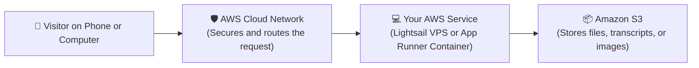

# ☁️ Amazon Web Services (AWS) Deployment Made Simple

> **In Plain English:**  
> Amazon Web Services (AWS) is the biggest cloud provider in the world.  
> It has hundreds of services, which can feel overwhelming. This guide cuts through the noise and shows you the **two best ways** to host your app on AWS without overpaying or getting confused.

---

## 📑 Table of Contents
1. [The Big Picture (How AWS Connects Visitors to Your App)](#1-the-big-picture)
2. [The Best 3 Ways to Host on AWS](#2-the-best-3-ways-to-host-on-aws)
   - [Pick 1: AWS Lightsail (Best for Fixed Budget: $3.50/month)](#pick-1-aws-lightsail-the-no-surprise-bills-option)
   - [Pick 2: AWS App Runner (Easiest Managed Container)](#pick-2-aws-app-runner-the-easy-hands-off-option)
   - [Pick 3: Amazon EC2 (When You Need a Dedicated AI GPU)](#pick-3-amazon-ec2-for-full-control--gpus)
3. [Simple AWS Comparison Table](#3-simple-aws-comparison-table)
4. [Which One Fits Your App?](#4-which-one-fits-your-app)
5. [Easy Step-by-Step Instructions for AWS Lightsail](#5-easy-step-by-step-instructions-for-aws-lightsail)
6. [How to Avoid Surprise Charges on AWS](#6-how-to-avoid-surprise-charges-on-aws)

---

## 1. The Big Picture

Here is how traffic flows to your app on AWS:



---

## 2. The Best 3 Ways to Host on AWS

### Pick 1: AWS Lightsail (The "No Surprise Bills" Option)
* **What is it?**  
  Lightsail gives you a small, dedicated virtual computer in the cloud for a **fixed monthly price** (just like paying a flat subscription for Netflix).
* **Why it's great:**
  * **Zero Billing Surprises**: You pay **$3.50 or $5.00 a month**. That's it.
  * **Free Data Transfer**: It comes with 1,000 GB (1 Terabyte) to 2,000 GB of free internet traffic every month.
  * **Static Public IP Included**: You get a permanent IP address for free, which is great for web scrapers or pointing your domain name.
  * **Full Freedom**: You can install Docker, Python, Streamlit, or Nginx with full administrator ("root") access.
* **Trade-off**: You are in charge of updating your Linux server occasionally.

---

### Pick 2: AWS App Runner (The Easy "Hands-Off" Option)
* **What is it?**  
  You connect your GitHub repository or Docker container, and Amazon handles the rest. You never see or manage an operating system.
* **Why it's great:**
  * **Automatic Updates**: When you push new code to GitHub, AWS automatically rebuilds and updates your live app.
  * **Supports WebSockets**: Great for Streamlit dashboards and live AI streaming.
* **Trade-off**: **It does NOT scale to $0**. Even when nobody is using your app, AWS keeps memory reserved and charges you around **$5.00 to $12.00 a month**. If you want a 100% free tier, choose Google Cloud Run instead.

---

### Pick 3: Amazon EC2 (For Full Control & AI GPUs)
* **What is it?**  
  Amazon's classic virtual machine service.
* **When to use it:**
  * If you need an **Nvidia graphics card (like the Nvidia T4 GPU on `g4dn.xlarge`)** to run your own AI models (Ollama, Whisper, PyTorch).
  * With Amazon Spot instances, an EC2 GPU server costs around **$115/month** (compared to ~$85/month on Google Cloud).

---

## 3. Simple AWS Comparison Table

| Feature | 💡 AWS Lightsail | 🚀 AWS App Runner | 🖥️ Amazon EC2 (GPU) |
|---|---|---|---|
| **What is it?** | Fixed-rate virtual private server | Fully managed container app | Custom virtual machine |
| **Monthly Cost** | **$3.50 – $5.00 flat** | ~$5.00 – $25.00 | ~$115.00 (with GPU) |
| **Difficulty Level** | ⭐⭐ (Easy) | ⭐ (Very Easy) | ⭐⭐⭐ (Intermediate) |
| **Risk of Surprise Bill** | **0% (Flat monthly price)** | Low | Medium |
| **Includes Free Bandwidth?** | **Yes (1,000 GB free)** | Pay per GB used | Pay per GB used |
| **GPU for AI Models?** | ❌ No | ❌ No | ✅ **Yes (Nvidia T4)** |

---

## 4. Which One Fits Your App?

* Choose **AWS Lightsail** if:
  * You are a student, freelancer, or small startup with a strict $5/month budget.
  * You want peace of mind knowing your bill will never unexpectedly spike.
* Choose **AWS App Runner** if:
  * You already have an AWS account with your team and want a hands-off deployment directly from your GitHub repository.
* Choose **Amazon EC2** if:
  * You need a dedicated Nvidia graphics card to run local AI models.

---

## 5. Easy Step-by-Step Instructions for AWS Lightsail

Here is the easiest way to launch a $3.50/month server on AWS:

### Step 1: Open the AWS Console
1. Go to [lightsail.aws.amazon.com](https://lightsail.aws.amazon.com/) and log in with your AWS account.
2. Click the big orange button: **"Create instance"**.

### Step 2: Choose Your Server Settings
* **Location**: Pick a region close to you or your users (e.g., Virginia or Frankfurt).
* **Platform**: Select **Linux/Unix**.
* **Blueprint**: Select **OS Only** -> **Ubuntu 22.04 LTS**.
* **Instance Plan**: Select the **$3.50/month** or **$5.00/month** plan.
* **Name**: Type `my-app` and click **"Create instance"**.

### Step 3: Connect and Run Your App
1. Wait 60 seconds until the instance says "Running".
2. Click the small terminal icon `>_` to open a browser terminal.
3. Install Docker and run your app with these simple commands:
```bash
# 1. Update server packages
sudo apt update && sudo apt install -y docker.io docker-compose git

# 2. Clone your code
git clone https://github.com/YOUR_USERNAME/YOUR_REPO.git
cd YOUR_REPO

# 3. Start your app in the background
sudo docker run -d -p 80:8501 --restart always $(sudo docker build -q .)
```

Your app is now live on the server's public IP address!

---

## 6. How to Avoid Surprise Charges on AWS

1. **Set a Billing Alarm First Thing**:
   * Open the AWS Console, search for **Billing and Cost Management**, and turn on **Receive Billing Alerts**.
   * Set an alarm to email you if your total charges exceed **$10.00**.
2. **Watch Out for Unused Elastic IPs**:
   * On EC2, if you reserve a public IP address and don't attach it to a running server, Amazon charges a small fee. On Lightsail, this is included for free.
3. **Delete Unused Disks**:
   * If you terminate an EC2 server, always check that its storage disk (EBS) was deleted as well.
