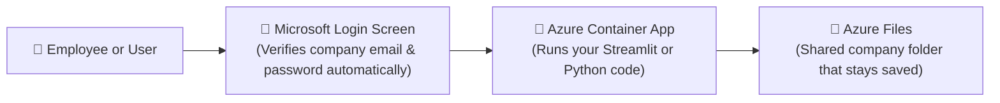

# 🔷 Microsoft Azure Deployment Made Simple

> **In Plain English:**  
> Microsoft Azure is Microsoft's cloud platform.  
> It is the undisputed champion for **company intranets, corporate tools, and apps that need users to log in with their work Microsoft / Office 365 accounts**.

---

## 📑 Table of Contents
1. [The Big Picture (How Azure Connects Visitors to Your App)](#1-the-big-picture)
2. [The Best 2 Ways to Host on Azure](#2-the-best-2-ways-to-host-on-azure)
   - [Pick 1: Azure Container Apps (Recommended for Most People)](#pick-1-azure-container-apps-the-modern-serverless-choice)
   - [Pick 2: Azure App Service (For Classic Enterprise Web Hosting)](#pick-2-azure-app-service-for-traditional-teams)
3. [Simple Azure Comparison Table](#3-simple-azure-comparison-table)
4. [Azure's Superpower: One-Click Microsoft Login](#4-azures-superpower-one-click-microsoft-login)
5. [Easy Step-by-Step Instructions for Azure Container Apps](#5-easy-step-by-step-instructions)
6. [How to Keep Azure Costs Low](#6-how-to-keep-azure-costs-low)

---

## 1. The Big Picture

Here is how an employee or visitor reaches your app on Azure:



---

## 2. The Best 2 Ways to Host on Azure

### Pick 1: Azure Container Apps (The Modern Serverless Choice)
* **What is it?**  
  Azure's newest, easiest container hosting service. You just hand Azure your containerized app, and it runs it automatically.
* **Why it's great:**
  * **Turns Off When Not in Use**: If your coworkers only use the app during business hours (9 AM – 5 PM), it shuts down at night and costs you **$0**.
  * **Free Monthly Allowance**: Azure gives you a generous free tier every month (180,000 vCPU-seconds and 360,000 GiB-seconds free). Low-traffic internal tools often cost **under $2/month**.
  * **Works with Streamlit & WebSockets**: Supports persistent live streaming connections out of the box.
  * **Shared File Storage**: You can mount an "Azure Files" folder directly into the container so your app can read and write files that never disappear.

---

### Pick 2: Azure App Service (For Traditional Teams)
* **What is it?**  
  Microsoft's classic website hosting service, running since 2012.
* **Why teams use it:**
  * **Deployment Slots (Testing Safe)**: You can push new code to a private "staging" link, test it with your team, and then swap it into the "live" version in one click with zero downtime.
  * **Predictable Monthly Price**: Starts around **~$13.00/month** on the B1 Basic plan.

---

## 3. Simple Azure Comparison Table

| Feature | 🚀 Azure Container Apps (ACA) | 🏢 Azure App Service |
|---|---|---|
| **What is it?** | Modern serverless containers | Classic web hosting plan |
| **Turns off when empty?** | ✅ **Yes (Scales to 0)** | ❌ No (Runs 24/7) |
| **Expected Monthly Cost** | **$0.00 – $8.00 / month** | **~$13.00 – $55.00 / month** |
| **Has a Free Tier?** | ✅ **Yes (Generous free allowance)** | Limited free tier (no custom domain) |
| **One-Click Microsoft Login?** | ✅ **Yes (Easy Auth)** | ✅ **Yes (Easy Auth)** |
| **Persistent Folder Mount?** | ✅ **Yes (Azure Files SMB)** | ✅ Yes (Shared storage) |

---

## 4. Azure's Superpower: One-Click Microsoft Login

If you build an internal tool (like a company video transcriber, an HR portal, or a sales dashboard), you usually don't want the public internet to see it.

Normally, building user logins with passwords, passwords resets, and two-factor authentication takes weeks of difficult coding.

**On Azure, you don't write a single line of authentication code:**
1. You turn on **"Easy Auth"** in the Azure portal.
2. Azure automatically places a Microsoft login wall in front of your website.
3. Only people with an authorized `@yourcompany.com` email address can sign in.
4. Your Python app automatically receives the logged-in user's name and email in the web headers!

---

## 5. Easy Step-by-Step Instructions

Here is how to deploy your app to Azure Container Apps:

### Step 1: Install the Free Azure CLI
Download and install the [Azure CLI](https://learn.microsoft.com/en-us/cli/azure/install-azure-cli).

### Step 2: Log in to Your Azure Account
```bash
az login
```
*(A browser tab will open to log in with your Microsoft account).*

### Step 3: Deploy Your App with One Command
Run this command in your project folder:
```bash
az containerapp up \
  --name my-app \
  --resource-group my-resource-group \
  --location eastus \
  --source . \
  --ingress external \
  --target-port 8501
```

**What this does:**
* Builds your app container automatically in Azure.
* Creates the serverless container app in the `eastus` data center.
* Makes port `8501` (Streamlit's port) accessible on a secure public `https://` link.

---

## 6. How to Keep Azure Costs Low

1. **Keep Minimum Replicas at 0**:  
   Make sure `--min-replicas 0` is set on your Container App. That way, when your team goes home for the weekend, you are charged **$0**.
2. **Delete Empty Resource Groups**:  
   Azure organizes servers into "Resource Groups". When you are done testing a project, deleting the resource group instantly deletes all servers, disks, and databases inside it so nothing keeps charging you.
3. **Use Azure Files (Cool Tier)**:  
   If you store transcripts or audio files in Azure Storage, choose the **Cool tier**. It is much cheaper for files you only read occasionally.
