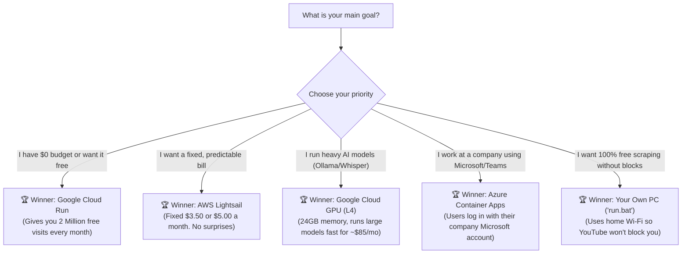

# 📊 Cloud Comparison & Decision Guide: Choosing the Right Cloud in Plain English

> **What is this guide?**  
> We compared the three biggest cloud companies in the world — **Amazon Web Services (AWS)**, **Microsoft Azure**, and **Google Cloud Platform (GCP)**.  
> This guide translates all the technical cloud jargon into clear, simple English so you can pick the best and cheapest home for your app in under 5 minutes.

---

## 1. ⚖️ Head-to-Head Comparison (Explained Simply)

| What You Need | ☁️ Amazon Web Services (AWS) | 🔷 Microsoft Azure | 🇬 Google Cloud (GCP) | What This Means in Everyday English |
| :--- | :--- | :--- | :--- | :--- |
| **Best Easy Hosting** | **AWS App Runner** | **Azure Container Apps** | **Google Cloud Run** | Where you put your containerized app without managing whole computers. |
| **Setup Simplicity** | ⭐⭐⭐ (A bit tricky) | ⭐⭐⭐ (Average) | ⭐⭐⭐⭐⭐ **(Easiest by far)** | How fast a beginner can get their app live on the internet. |
| **Deployment Effort** | Several complicated steps | Moderate Azure CLI commands | **Just 1 command: `gcloud run deploy`** | How many buttons you have to click or terminal commands to type. |
| **Turning off when unused ($0 idle)** | ⚠️ Keeps charging for memory | ✅ Yes, turns off completely | ✅ **Yes, turns off completely** | If nobody visits your site at 3 AM, do you pay $0? Google and Azure say yes! |
| **Wake-up speed (Cold start)** | 10 to 20 seconds | 15 to 30 seconds | **2 to 5 seconds (Super fast)** | When someone visits your sleeping app, how long before the page opens? |
| **Live Chat & Streaming (WebSockets)**| ✅ Supported | ✅ Supported | ✅ **Supported up to 60 minutes** | Needed for Streamlit and live AI streaming so connections don't drop. |
| **Free Tier Every Month** | Trial credits only (expires) | Small free allowance | **2,000,000 Free visits every month** | Google gives you 2 million free web requests every single month forever. |
| **AI Graphics Brain (GPU)** | Nvidia T4 ($115/mo) | Nvidia T4 ($95/mo) | **Nvidia L4 ($85/mo) - Modern 24GB** | Hardware needed to run private AI models like Whisper or Ollama. |
| **Base Cost if Nobody Uses It** | ~$5 to $15 / month | $0 to $8 / month | **$0.00 / month** | What shows up on your credit card if your app gets zero visitors. |

---

## 2. 🎯 The Decision Flowchart: Which One Fits You?

---

## 3. 🎯 10 Common Real-World Scenarios & Winners

### Scenario 1: Personal Projects, Student Work & Hobby Apps (<$2/month)
* **🏆 Winner**: **Google Cloud Run (GCP)**
* **🥈 Runner-Up**: Azure Container Apps
* **❌ Avoid**: AWS App Runner (charges you ~$5 to $12 every month even if nobody visits).
* **Why Google Wins**:
  * Google gives you **2 million free web requests every single month**.
  * When nobody is visiting your website, the computer shuts down and charges you **$0.00**.
  * When a visitor clicks your link, it wakes up in just 3 seconds. For hobby apps, your monthly bill will literally be **$0.00**.

---

### Scenario 2: Quick Startup Prototype (Streamlit or FastAPI)
* **🏆 Winner**: **Google Cloud Run (GCP)**
* **🥈 Runner-Up**: AWS App Runner
* **Why Google Wins**:
  * **Super Fast to Launch**: You type `gcloud run deploy --source .` in your terminal, and within 2 minutes you get a live `https://` link to share with anyone in the world.
  * **Built for Live Streaming**: Streamlit uses "WebSockets" (an open phone line between the browser and server). Google lets connections stay open for up to 60 minutes without disconnecting.
  * **Cheapest for Early MVPs**: $0 to $3 per month for normal testing traffic.

---

### Scenario 3: Running Your Own AI Models (Ollama, Whisper, PyTorch)
* **🏆 Winner**: **Google Cloud Compute Engine with Nvidia L4 GPU**
* **🥈 Runner-Up**: AWS EC2 `g4dn.xlarge` (Nvidia T4 GPU)
* **❌ Avoid**: Regular serverless containers (they don't have graphics cards attached).
* **Why Google Wins**:
  * AI models like Llama 3 and Whisper need lots of video memory (VRAM). Google offers the modern **Nvidia L4 GPU with 24GB of memory**.
  * Amazon's budget GPU only has 16GB of memory and uses older technology.
  * By choosing Google's "Spot" pricing (discounted spare computers), it costs only **~$85/month** compared to ~$115/month on AWS.

---

### Scenario 4: Predictable Monthly Budget (Zero Billing Surprises)
* **🏆 Winner**: **AWS Lightsail**
* **🥈 Runner-Up**: DigitalOcean or Linode
* **Why AWS Wins**:
  * Some cloud services charge you extra for internet bandwidth, storage, and CPU minutes, leading to unexpected credit card charges.
  * **AWS Lightsail works just like Netflix**: You pay a **flat $3.50 or $5.00 a month**.
  * It includes plenty of free internet data (1,000 GB to 2,000 GB per month). Even if your site gets busy, your bill does not spike.

---

### Scenario 5: Scraping Websites & YouTube Transcribers
* **🏆 Winner**: **Run on your own computer with `run.bat` (100% Free)** OR **Google Cloud Run + Cloud NAT**
* **Why**:
  * Websites like YouTube actively detect and block data center computers (AWS, Google, and Azure servers).
  * **Best Zero-Cost Trick**: Run the app on your home or office computer using the included [`run.bat`](file:///d:/AI/transcribe/run.bat) launcher. Because your computer uses normal home Wi-Fi (a "residential IP"), YouTube treats you like a regular human watching a video and never blocks you. Cost: **$0.00**.
  * **If you must use the cloud**: Use Google Cloud Run paired with a static IP ("Cloud NAT") so YouTube doesn't see a random shared server IP.

---

### Scenario 6: Company Apps with Microsoft 365 / Outlook Login
* **🏆 Winner**: **Azure Container Apps / Azure App Service**
* **🥈 Runner-Up**: AWS ECS on Fargate
* **Why Azure Wins**:
  * If your company uses Microsoft 365, Teams, or Outlook, Microsoft Azure lets you turn on company login with **one click** (called "Easy Auth").
  * You don't have to write any login or password code in your app! Azure handles the login screen and verifies who the employee is automatically.
  * You can also mount company shared folders ("Azure Files") directly into the app.

---

### Scenario 7: High-Volume 24/7 Traffic (Established Business)
* **🏆 Winner**: **AWS EC2 Graviton (t4g/c7g servers)**
* **🥈 Runner-Up**: Google Cloud Compute Engine
* **Why AWS Wins**:
  * When your app receives millions of visits every single day, "serverless" (paying per second) becomes more expensive than renting a dedicated computer 24/7.
  * Amazon's custom **Graviton chips** give you the most computing power for the lowest price in the industry (up to 40% cheaper than regular Intel chips).
  * If you commit to a 1-year or 3-year plan, you get huge discounts (as low as **~$11.50/month**).

---

### Scenario 8: Sudden Viral Traffic Spikes
* **🏆 Winner**: **Google Cloud Run (GCP)**
* **🥈 Runner-Up**: Azure Container Apps
* **Why Google Wins**:
  * If your app gets mentioned on social media or news, 50,000 people might show up in 10 minutes.
  * Google Cloud Run automatically clones your app from 1 copy to 500 copies in seconds to handle the traffic without crashing.
  * As soon as the visitors leave, all extra copies turn off so you don't keep paying for them.

---

### Scenario 9: Many Microservices Talking to Each Other
* **🏆 Winner**: **AWS ECS with Fargate**
* **🥈 Runner-Up**: Azure Container Apps
* **Why AWS Wins**:
  * If you have 5 different apps (like a frontend, a database, a background worker, and a cache) that need to talk to each other safely, AWS ECS is the most mature and battle-tested tool in the world.
  * It connects seamlessly to Amazon databases, file storage, and message queues.

---

### Scenario 10: Worldwide Fast Loading (Global App)
* **🏆 Winner**: **Google Cloud Run (Multi-Region)**
* **🥈 Runner-Up**: AWS CloudFront + App Runner
* **Why Google Wins**:
  * Google owns one of the largest private fiber optic internet networks on Earth.
  * You can put your app in the US, Europe, and Asia simultaneously. Google automatically sends visitors in London to the Europe computer, and visitors in Tokyo to the Asia computer, making your app load instantly worldwide.

---

## 4. 📋 Summary Cheat-Sheet

| Your Project Type | Recommended Cloud | Recommended Service | What You Will Pay |
|---|---|---|---|
| **Personal / Student / Free Project** | **Google Cloud (GCP)** | **Cloud Run** | **$0.00 / month (Free)** |
| **Streamlit or FastAPI Prototype** | **Google Cloud (GCP)** | **Cloud Run** | **$0.00 – $2.00 / month** |
| **Heavy AI Model (Ollama, Whisper)** | **Google Cloud (GCP)** | **Compute Engine (L4 GPU)** | **~$85.00 / month** |
| **Strict Fixed Budget (No surprises)** | **Amazon Web Services (AWS)** | **AWS Lightsail** | **$3.50 – $5.00 / month flat** |
| **Company App with Microsoft Login** | **Microsoft Azure** | **Azure Container Apps** | **$0.00 – $15.00 / month** |
| **Web Scraper (YouTube Transcriber)** | **Your Own PC** | **Local `run.bat`** | **$0.00 / month** |
| **Established App with 24/7 Traffic** | **Amazon Web Services (AWS)** | **EC2 Graviton** | **~$11.50 / month** |

---

## 5. 🛡️ 5 Golden Rules to Never Get a Surprise Bill

No matter which cloud you pick, follow these 5 simple rules:

1. **Set a $10 Budget Alert on Day 1**:
   * Go to the billing page of AWS, Azure, or Google Cloud and create an alert: *"Send me an email and text if my bill reaches $10."* This protects you against accidental mistakes.
2. **Always Enable "Scale to Zero"**:
   * Make sure minimum instances is set to `0` (`--min-instances 0`). This ensures you pay nothing when you are asleep or not using the app.
3. **Use "Spot" for AI and Experimentation**:
   * "Spot" means renting unused cloud computers at up to an **80% discount**.
4. **Don't Overpay for Memory**:
   * For standard Python and Streamlit apps, **1 vCPU and 1GB to 2GB of RAM** is plenty. Don't select 8 CPUs or 32GB of RAM unless you are training AI models.
5. **Delete Old Test Servers**:
   * If you finish testing a server, stop it or delete it so it doesn't quietly bill you month after month.
