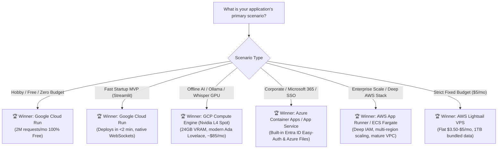

# 📊 Tri-Cloud Deployment Strategies & Scenario Decision Matrix

This document provides a comprehensive comparative evaluation of **Amazon Web Services (AWS)**, **Microsoft Azure**, and **Google Cloud Platform (GCP)** for deploying Python, Streamlit, FastAPI, and AI applications (such as *YouTranscribe*, *JARVIS*, *Ollama*, and *Reader*).

For exhaustive platform-specific implementation guides, refer to:
* ☁️ **[`AWS_Deployment.md`](./AWS_Deployment.md)** — App Runner, ECS Fargate, EC2 CPU/GPU, Lightsail, and CI/CD.
* 🔷 **[`Azure_Deployment.md`](./Azure_Deployment.md)** — Container Apps (ACA), App Service, NC-Series GPUs, and Entra ID.
* 🇬 **[`GCP_Deployment.md`](./GCP_Deployment.md)** — Cloud Run, GCE L4/T4 GPUs, GCS FUSE volumes, and Cloud NAT.

---

## 1. ⚖️ Tri-Cloud Head-to-Head Comparison Matrix

| Evaluation Dimension | ☁️ Amazon Web Services (AWS) | 🔷 Microsoft Azure | 🇬 Google Cloud Platform (GCP) |
| :--- | :--- | :--- | :--- |
| **Flagship Serverless Container** | **AWS App Runner** | **Azure Container Apps (ACA)** | **Google Cloud Run** |
| **Setup Speed & Simplicity** | ⭐⭐⭐ (Good) | ⭐⭐⭐ (Good) | ⭐⭐⭐⭐⭐ **(Fastest in Industry)** |
| **Deployment Command** | Multi-step ECR + App Runner config | `az acr build` + `az containerapp create` | **1 Command: `gcloud run deploy`** |
| **Concurrency Model** | Dedicated instances per threshold | Pod replicas via KEDA | **Up to 1,000 reqs/container instance** |
| **Scale-to-Zero Capability** | Partial (vCPU pauses, memory billed) | Yes (Scales down to 0 replicas) | **Yes (100% idle stop, $0 cost)** |
| **Cold Start Duration** | 10 – 20 seconds | 15 – 30 seconds | **2 – 5 seconds** |
| **Native WebSocket Streaming** | Yes (Built-in) | Yes (Envoy Ingress) | **Yes (Up to 60-min timeouts)** |
| **Monthly Free Tier** | Free trial credits only | 180,000 vCPU-s, 360,000 GiB-s | **2,000,000 Requests / Month FREE** |
| **Persistent Storage Mount** | Amazon EFS (ECS only) | Azure Files (SMB Mount) | **Google Cloud Storage (GCS FUSE)** |
| **Modern AI GPU Hardware** | Nvidia T4 (`g4dn`) / A10G (`g5`) | Nvidia T4 (`NCas_T4_v3`) | **Nvidia L4 24GB (`g2`) / T4 (`n1`)** |
| **Base Monthly Cost (Idle)** | ~\$5.00 – \$15.00 / month | ~\$0.00 – \$8.00 / month | **\$0.00 / month** |
| **CLI / Developer Experience** | Verbose JSON / AWS CLI | Structured `az` CLI | Clean, intuitive `gcloud` interactive CLI |

---

## 2. 🎯 Scenario-by-Scenario In-Depth Recommendations

---

### Scenario 1: Solo Developer / Hobby Project / Zero Budget (<$2/month)
* **🏆 Winner**: **Google Cloud Run (GCP)**
* **🥈 Runner-Up**: Azure Container Apps (ACA)
* **❌ Avoid**: AWS App Runner or AWS ECS Fargate (minimum idle charges apply).
* **Why GCP Wins**:
  * Cloud Run provides an **unrivaled free tier**: the first **2,000,000 requests**, 360,000 vCPU-seconds, and 180,000 GiB-seconds are free every single month.
  * For personal tools, portfolio demos, or hobby transcription apps, your monthly bill will literally be **\$0.00**.
  * Complete scale-to-zero means you never pay for compute while you sleep or when no one is using the site.
* **Cost Comparison**:
  * **GCP Cloud Run**: **\$0.00 / month** (within free tier).
  * **Azure Container Apps**: **\$0.00 – \$2.00 / month** (within free grant).
  * **AWS App Runner**: **~\$5.00 – \$12.00 / month** (provisioned memory is billed even when idle).

---

### Scenario 2: Rapid Startup MVP / Proof-of-Concept (Streamlit / FastAPI WebSockets)
* **🏆 Winner**: **Google Cloud Run (GCP)**
* **🥈 Runner-Up**: AWS App Runner
* **Why GCP Wins**:
  * **Velocity**: From local code to live public HTTPS URL takes **less than 2 minutes** with `gcloud run deploy --source .`.
  * **Native WebSocket Stability**: Streamlit relies on persistent WebSockets (`/_stcore/stream`). Cloud Run supports WebSockets out-of-the-box with configurable session timeouts up to **60 minutes** (3,600s), ensuring multi-hour video transcriptions never disconnect.
  * **High Concurrency**: A single container instance on Cloud Run can serve **up to 80–100 simultaneous users** before spinning up a second container, maximizing responsiveness while keeping costs minimal.
* **Cost Comparison**:
  * **GCP Cloud Run**: **~\$0.00 – \$5.00 / month** for low to moderate MVP traffic.
  * **AWS App Runner**: **~\$15.00 – \$25.00 / month**.
  * **Azure Container Apps**: **~\$5.00 – \$15.00 / month**.

---

### Scenario 3: Offline AI Inference & Local LLMs / Whisper (High VRAM GPU Workloads)
* **🏆 Winner**: **Google Compute Engine (GCE) `g2-standard-4` (Nvidia L4 GPU)**
* **🥈 Runner-Up**: AWS EC2 `g4dn.xlarge` (Nvidia T4 GPU)
* **❌ Avoid**: Serverless containers (Cloud Run, App Runner, ACA) — they lack dedicated persistent GPU acceleration.
* **Why GCP Wins**:
  * **Modern Architecture**: Google Cloud features the **Nvidia L4 GPU (24GB VRAM)** based on the modern Ada Lovelace architecture. It delivers **2x–3x the inference throughput** of the older Nvidia T4 for running **Ollama (Llama 3 8B/70B quantized), faster-whisper (Large-v3), and Stable Diffusion**.
  * **Unbeatable Spot Pricing**: GCP Spot VMs provide up to an **80% discount**, lowering an enterprise GPU instance from ~$280/month to **~$85.00/month**.
* **Cost Comparison (Continuous 24/7 Running)**:
  * **GCP Compute Engine (`g2-standard-4` Spot L4 24GB)**: **~\$85.00 / month**.
  * **AWS EC2 (`g4dn.xlarge` Spot T4 16GB)**: **~\$115.00 / month**.
  * **Azure VM (`NCas_T4_v3` Spot T4 16GB)**: **~\$95.00 / month**.

---

### Scenario 4: High-Volume, Steady 24/7 Production Traffic (Predictable SaaS)
* **🏆 Winner**: **AWS EC2 Graviton (t4g.medium / c7g.large) with 3-Year Savings Plan**
* **🥈 Runner-Up**: GCP Compute Engine (with Committed Use Discounts)
* **Why AWS Wins**:
  * When traffic is steady 24/7, serverless per-second pricing becomes more expensive than reserved virtual machines.
  * **AWS Graviton (ARM64)** instances (`t4g` / `c7g`) deliver the **highest compute-per-dollar ratio in the cloud industry**—costing up to **40% less** than comparable Intel/AMD instances.
  * Paired with an Application Load Balancer and Auto Scaling Group, it provides rock-solid uptime for millions of requests.
* **Cost Comparison (Steady Production Load)**:
  * **AWS EC2 `t4g.medium` (3-Yr Savings Plan)**: **~\$11.50 / month**.
  * **GCP Compute Engine `e2-standard-2` (Committed Use)**: **~\$22.00 / month**.
  * **Serverless Containers (App Runner / Cloud Run at 24/7 load)**: **~\$45.00 – \$65.00 / month**.

---

### Scenario 5: Unpredictable, Spiky Traffic (Viral Spikes & Long Inactivity)
* **🏆 Winner**: **Google Cloud Run (GCP)**
* **🥈 Runner-Up**: Azure Container Apps (ACA)
* **Why GCP Wins**:
  * **Rapid Autoscaling**: Cloud Run can scale from 0 to 1,000 container instances in seconds to absorb sudden viral surges, then instantly scale back to 0 when the wave subsides.
  * **Zero Idle Cost**: You are strictly billed only for the exact milliseconds during which requests are actively processing.
* **Cost Comparison**:
  * **GCP Cloud Run**: Only pays for spike duration (e.g., $1.50 for a 10,000-visitor burst, $0 when quiet).
  * **AWS App Runner**: Scales quickly, but provisioned container memory keeps billing after the spike.
  * **Standard VM (EC2 / GCE)**: Forces you to over-provision an expensive instance 24/7 just in case a spike occurs.

---

### Scenario 6: Corporate & Enterprise Environments (Microsoft 365, Entra ID, SOC2)
* **🏆 Winner**: **Azure Container Apps (ACA) & Azure App Service**
* **🥈 Runner-Up**: AWS ECS on Fargate
* **Why Azure Wins**:
  * **Built-in Enterprise SSO (Microsoft Entra ID / Easy Auth)**: You can secure your Streamlit application behind corporate corporate Active Directory login with **zero lines of authentication code**.
  * **Zero-Downtime Staging Slots**: Azure App Service allows deploying revisions to a `staging` slot, running internal verification, and swapping to `production` with zero downtime.
  * **Enterprise File Mounting**: Mounts **Azure Files** shares directly into containers, allowing all replicas to access shared company documents and transcript logs.
* **Cost Comparison**:
  * **Azure App Service (B1 Plan)**: **~\$13.00 / month** fixed.
  * **Azure Container Apps**: **~\$0.00 – \$15.00 / month** based on internal employee usage.
  * **AWS ECS Fargate + ALB**: **~\$25.00 – \$40.00 / month** (ALB baseline cost).

---

### Scenario 7: Multi-Service Microservices Architecture (Frontend, Auth, Celery, Redis)
* **🏆 Winner**: **Amazon ECS with AWS Fargate**
* **🥈 Runner-Up**: Azure Container Apps (with Dapr & KEDA)
* **Why AWS Wins**:
  * **Ecosystem Maturity**: AWS ECS is the industry standard for production microservices. Features like **AWS Service Connect**, **Amazon SQS**, **Amazon ElastiCache**, and **Amazon EFS** integrate natively with granular IAM execution roles.
  * **Shared Persistent Storage**: Multiple worker containers can mount a single **Amazon EFS** (NFS) volume to share large models, audio files, and transcripts in real time.
* **Cost Comparison**:
  * **AWS ECS Fargate (2 Microservices + ALB)**: **~\$35.00 – \$50.00 / month**.
  * **GKE Autopilot (Kubernetes Cluster Fee)**: **~\$74.00 / month base + pod costs**.

---

### Scenario 8: Web Scraping & YouTube Transcriber (Bypassing Datacenter IP Blocks)
* **🏆 Winner**: **Hybrid Local Execution with Tunnel (100% Free)** OR **GCP Cloud Run + Cloud NAT**
* **Why**:
  * YouTube actively throttles and blocks automated requests coming from shared cloud datacenter IP ranges (AWS, Azure, GCP).
  * **The Zero-Cost Residential Solution**: Running the Streamlit app on your local machine using [`run.bat`](file:///d:/AI/transcribe/run.bat) (Option 2) routes requests through your residential IP, completely bypassing YouTube's datacenter blocks with **\$0 hosting cost**.
  * **The Enterprise Cloud Solution**: If hosting on the cloud, GCP Cloud Run paired with a **Serverless VPC Connector** and **Cloud NAT Gateway** routes outbound egress through a dedicated static IP, avoiding shared blacklists.

---

### Scenario 9: Strict Predictable Budget (Flat-Fee Billing, Zero Overrun Risk)
* **🏆 Winner**: **AWS Lightsail**
* **🥈 Runner-Up**: DigitalOcean / Hetzner VPS
* **Why AWS Wins**:
  * Standard cloud architectures (ALB, NAT Gateways, Egress Bandwidth) can lead to unexpected surprise bills if traffic surges.
  * **AWS Lightsail** provides a **guaranteed flat monthly bill**:
    * **\$3.50/month**: 1 vCPU, 512MB RAM, 20GB SSD, 1TB free outbound data transfer.
    * **\$5.00/month**: 1 vCPU, 1GB RAM, 40GB SSD, 2TB free outbound data transfer.
  * Ideal for small businesses or students who need a fixed budget.

---

### Scenario 10: Global Low-Latency Edge Delivery (Worldwide Multi-Region)
* **🏆 Winner**: **Google Cloud Run (Multi-Region Anycast)**
* **🥈 Runner-Up**: AWS CloudFront + App Runner / Lambda@Edge
* **Why GCP Wins**:
  * Google operates its own private global fiber optic backbone.
  * Deploying a Cloud Run service to multiple regions (`us-central1`, `europe-west1`, `asia-east1`) behind a single **Global External Application Load Balancer** automatically routes users to the geographically closest container with **single-digit millisecond latency**.

---

## 3. 📋 Master Decision Cheat-Sheet Table

| Project Scenario / Goal | 🥇 Recommended Cloud | 🛠️ Recommended Service | 💵 Estimated Monthly Cost | ⏱️ Setup Time |
| :--- | :--- | :--- | :--- | :--- |
| **1. Free / Hobby / Personal MVP** | **Google Cloud (GCP)** | **Cloud Run** | **\$0.00** (Within Free Tier) | **< 2 mins** |
| **2. Streamlit Web App Prototype** | **Google Cloud (GCP)** | **Cloud Run** | **\$0.00 – \$2.00 / mo** | **< 5 mins** |
| **3. Offline AI / Local LLM / Ollama** | **Google Cloud (GCP)** | **Compute Engine (L4 GPU Spot)** | **~\$85.00 / mo** | **~15 mins** |
| **4. Low-Cost GPU Alternative** | **Amazon Web Services (AWS)** | **EC2 `g4dn.xlarge` (T4 GPU Spot)**| **~\$115.00 / mo** | **~20 mins** |
| **5. Steady 24/7 Production Traffic** | **Amazon Web Services (AWS)** | **EC2 Graviton (`t4g`) Reserved** | **~\$11.50 / mo** | **~25 mins** |
| **6. Corporate / Microsoft 365 SSO**| **Microsoft Azure** | **Azure Container Apps / App Service**| **\$0.00 – \$13.00 / mo** | **~15 mins** |
| **7. Multi-Container Microservices** | **Amazon Web Services (AWS)** | **Amazon ECS on AWS Fargate** | **~\$35.00 – \$50.00 / mo** | **~45 mins** |
| **8. Strict Fixed Budget (<$5/mo)** | **Amazon Web Services (AWS)** | **AWS Lightsail VPS** | **\$3.50 – \$5.00 / mo (Fixed)** | **~10 mins** |
| **9. Worldwide Multi-Region Scale** | **Google Cloud (GCP)** | **Cloud Run + Global Anycast LB** | **Pay-per-use usage** | **~30 mins** |
| **10. Zero-Cost YouTube Transcriber** | **Local Machine (Residential)** | **Streamlit + Tunnel (`run.bat`)** | **\$0.00 / mo** | **1-Click** |

---

## 4. 🛡️ Universal FinOps & Production Guardrails

Regardless of which cloud provider you choose, enforce these 5 non-negotiable rules on Day 1:

1. **Configure a Hard Billing Alert**:
   * Set a **\$10.00/month budget alert** in your cloud console with email/SMS notifications at 50%, 80%, and 100% of budget.
2. **Always Enable Scale-to-Zero for Dev/Staging**:
   * Keep `--min-instances 0` (GCP) or `--min-replicas 0` (Azure) so non-production services generate zero charges overnight and on weekends.
3. **Use Spot / Preemptible Instances for Batch AI**:
   * For training, batch transcription, or background worker nodes, Spot VMs deliver **60% to 90% cost savings** over standard on-demand pricing.
4. **Right-Size Memory Allocations**:
   * For standard Streamlit web apps without local AI models, allocate **1 vCPU and 1GB to 2GB RAM**. Over-allocating to 4 vCPUs needlessly triples hourly compute billing.
5. **Enforce Container Image Lifecycle Policies**:
   * Configure your container registry (ECR, ACR, or Artifact Registry) to retain only the **last 3 tagged revisions**, preventing untagged Docker layers from accumulating silent storage fees.
