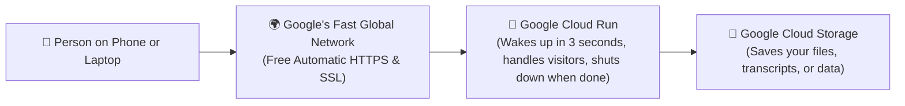

# 🇬 Google Cloud (GCP) Deployment Made Simple

> **In Plain English:**  
> Google Cloud Platform (GCP) is the same global computer network that powers Google Search, YouTube, and Gmail.  
> For 90% of web apps, Python tools, and Streamlit dashboards, **Google Cloud Run is the absolute best and cheapest place to host on the internet today**.

---

## 📑 Table of Contents
1. [The Big Picture (How Traffic Reaches Your App)](#1-the-big-picture)
2. [The 3 Main Ways to Deploy on Google Cloud](#2-the-3-main-ways-to-deploy-on-google-cloud)
   - [Option 1: Google Cloud Run (Recommended for Almost Everyone)](#option-1-google-cloud-run-the-top-pick)
   - [Option 2: Compute Engine (When You Need an AI GPU)](#option-2-compute-engine-for-heavy-ai-and-gpus)
   - [Option 3: GKE Autopilot (For Big Kubernetes Teams)](#option-3-google-kubernetes-engine-gke)
3. [Simple Comparison Table](#3-simple-comparison-table)
4. [Which One Should You Choose?](#4-which-one-should-you-choose)
5. [Easy Step-by-Step Instructions for Cloud Run](#5-easy-step-by-step-instructions-for-cloud-run)
6. [Money-Saving Tips (Never Get a Surprise Bill)](#6-money-saving-tips)

---

## 1. The Big Picture

Here is how a visitor connects to your app on Google Cloud:



---

## 2. The 3 Main Ways to Deploy on Google Cloud

### Option 1: Google Cloud Run (The Top Pick)
* **What is it?**  
  You give Google your code or container. Google gives you a live `https://` link. You don't have to manage a Windows or Linux operating system.
* **Why it's amazing:**
  * **2 Million Free Visits Every Month**: Google gives you a permanent monthly free tier. For personal tools and student projects, you will pay **$0.00**.
  * **Turns Off Completely When Inactive**: If nobody visits your website between midnight and 8 AM, the app sleeps and costs you **$0**. When someone visits, it wakes up in just **2 to 4 seconds**.
  * **Handles Many People at Once**: One single container can serve up to 80 to 1,000 visitors at the same time before Google creates a second copy.
  * **Perfect for Streamlit**: Streamlit needs a live connection ("WebSocket") to stream AI responses. Cloud Run keeps connections open for up to 60 minutes without disconnecting.
* **When NOT to use it**: If your app needs a physical graphics card (GPU) inside the server to run local AI models like Ollama.

---

### Option 2: Compute Engine (For Heavy AI and GPUs)
* **What is it?**  
  Renting an entire virtual computer running Linux or Windows in Google's data center.
* **Why it's great for AI:**
  * You can attach a high-powered **Nvidia L4 graphics card (24GB memory)**.
  * This is required if you want to run offline AI models like **Ollama (Llama 3 8B/14B)** or **Whisper Large (audio transcription)** directly on your own server.
  * By using **Spot Pricing** (renting spare computers that Google has available), you get up to an **80% discount**—paying around **$85/month** instead of $280/month.
* **When NOT to use it**: If you just have a standard website or API that doesn't need a heavy GPU. Cloud Run is much easier and cheaper for normal apps.

---

### Option 3: Google Kubernetes Engine (GKE)
* **What is it?**  
  A powerful enterprise tool for running dozens of microservices that talk to each other.
* **Who is it for?** Large software companies with dedicated DevOps teams. Beginners should skip this, as it costs at least ~$74/month just for the cluster management fee.

---

## 3. Simple Comparison Table

| Feature | 🚀 Google Cloud Run | 💻 Compute Engine (VM) | ☸️ GKE (Kubernetes) |
|---|---|---|---|
| **Best For** | Websites, Streamlit, APIs | AI Models (Ollama, Whisper) | Big enterprise microservices |
| **Setup Time** | **2 minutes** | 15 minutes | 45 minutes |
| **Maintenance** | **Zero (Google manages it)** | You must update Linux & drivers | High (Requires DevOps skills) |
| **Cost if Idle** | **$0.00 (Turns off)** | ~$15 to $85 / month (Always on) | ~$74+ / month |
| **Free Tier** | **2,000,000 visits / month** | None | Small free trial credit |
| **GPU for AI** | ❌ Not supported | ✅ **Yes (Nvidia L4 24GB)** | ✅ Yes |

---

## 4. Which One Should You Choose?

* Choose **Google Cloud Run** if:
  * You have a website, Streamlit app, or Python API.
  * You want your monthly bill to be **$0 to $5**.
  * You don't want to manage a Linux server or install security patches.
* Choose **Compute Engine with a GPU** if:
  * You are running a private AI model (like Ollama or local Whisper) and need a dedicated 24GB Nvidia graphics card.
* Choose **Local on your own PC** (see [`run.bat`](file:///d:/AI/transcribe/run.bat)) if:
  * You are scraping YouTube or websites that block data center servers, and you want it 100% free.

---

## 5. Easy Step-by-Step Instructions for Cloud Run

Here is how to deploy your app in 3 simple commands:

### Step 1: Install the Google Cloud Tool
Download and install the free [Google Cloud CLI](https://cloud.google.com/sdk/docs/install).

### Step 2: Log In to Google
Open your terminal (PowerShell or Command Prompt) and type:
```bash
gcloud auth login
```
*(A browser window opens. Click your Google account to log in).*

### Step 3: Deploy in One Single Command!
Go to your project folder and run:
```bash
gcloud run deploy my-app \
  --source . \
  --region us-central1 \
  --allow-unauthenticated \
  --port 8501 \
  --timeout 3600
```

**What each part of this command does:**
* `gcloud run deploy my-app`: Tells Google to deploy your app and name it `my-app`.
* `--source .`: Tells Google to take the code from your current folder.
* `--region us-central1`: Puts your app in Google's central US data center (very fast and cheap).
* `--allow-unauthenticated`: Makes your app public so anyone with the link can visit it.
* `--port 8501`: Sets the port (8501 is the standard port for Streamlit apps).
* `--timeout 3600`: Keeps connections open for up to 1 hour so live chat or video transcription never disconnects.

When the command finishes, Google prints a live public link like:  
👉 `https://my-app-xxxxxx.a.run.app`

Send that link to anyone in the world and your app is live!

---

## 6. Money-Saving Tips

1. **Keep Minimum Instances at 0**:  
   Make sure `--min-instances 0` is set. This guarantees that when nobody is using the site, you pay **$0**.
2. **Set a Billing Alert**:  
   Visit the [Google Cloud Billing Console](https://console.cloud.google.com/billing) and set an alert to email you if your monthly spending exceeds **$5.00**.
3. **Use Spot VMs for GPU Testing**:  
   If you ever rent an AI GPU on Compute Engine, always check the **Spot** box. It cuts the price by up to 80%!
