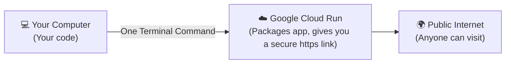
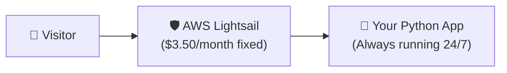
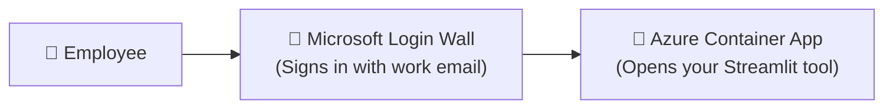

# 🛠️ Simple Step-by-Step Deployment Cookbook

> **Don't panic!**  
> You don't need to be a cloud wizard or have years of DevOps experience.  
> Just find the strategy below that matches your project and follow the numbered steps. Each command is explained in simple, plain English.

---

## 📑 Pick Your Recipe

| Strategy | When to Use It | Cost |
|---|---|---|
| [**Recipe 1: Google Cloud Run**](#recipe-1-google-cloud-run-free-or-almost-free) | Your website, Streamlit app, or Python API | **$0.00 – $2.00 / mo** (Free Tier) |
| [**Recipe 2: AWS Lightsail**](#recipe-2-aws-lightsail-fixed-budget-vps) | You want a fixed, predictable $3.50/mo bill | **$3.50 – $5.00 / mo flat** |
| [**Recipe 3: Azure Container Apps**](#recipe-3-azure-container-apps-corporate-microsoft-login) | Company app with Microsoft 365 login | **$0.00 – $15.00 / mo** |
| [**Recipe 4: AWS App Runner**](#recipe-4-aws-app-runner-hands-off-aws-containers) | Hands-off container hosting on AWS | **~$5.00 – $15.00 / mo** |
| [**Recipe 5: Google Cloud AI GPU Host**](#recipe-5-google-cloud-ai-gpu-host-ollama--whisper) | Running your own heavy AI models (Ollama, Whisper) | **~$85.00 / mo** (Spot) |
| [**Recipe 6: AWS EC2 GPU Host**](#recipe-6-aws-ec2-gpu-host-nvidia-t4) | Running AI models on AWS | **~$115.00 / mo** (Spot) |
| [**Recipe 7: Run on Your Own PC (Local)**](#recipe-7-run-on-your-own-pc-100-free-with-tunnel) | 100% free scraping and personal testing | **$0.00 (Free forever)** |

---

## Recipe 1: Google Cloud Run (Free or Almost Free)

**Best for**: Streamlit apps, FastAPI, web dashboards, and hobby projects.

### How It Works



### Step 1: Make sure you have a `Dockerfile`
A `Dockerfile` is just a recipe card telling the cloud how to run your Python app. Create a file named `Dockerfile` in your project folder with this content:

```dockerfile
FROM python:3.11-slim
WORKDIR /app
COPY requirements.txt .
RUN pip install --no-cache-dir -r requirements.txt
COPY . .
ENV PORT=8501
EXPOSE 8501
CMD exec streamlit run app.py --server.port=${PORT} --server.address=0.0.0.0 --server.headless=true
```

### Step 2: Log into Google Cloud
Open your terminal and type:
```bash
# 1. Log in with your Google account
gcloud auth login

# 2. Select your Google project
gcloud config set project YOUR_PROJECT_ID
```

### Step 3: Launch with One Single Command!
Run this command from your project folder:
```bash
gcloud run deploy my-app \
  --source . \
  --region us-central1 \
  --allow-unauthenticated \
  --port 8501 \
  --timeout 3600
```

**What each setting means:**
* `--source .`: Use the code in this folder.
* `--region us-central1`: Run in Google's central US data center.
* `--allow-unauthenticated`: Let anyone with the link view the site without a Google login.
* `--port 8501`: Streamlit's default port.
* `--timeout 3600`: Keeps live streaming and chat connections open for up to 1 hour without dropping.

**How do I know it worked?**  
Google will print a link like `https://my-app-xxxxxx.a.run.app`. Click it, and your app is live!

---

## Recipe 2: AWS Lightsail (Fixed Budget VPS)

**Best for**: When you want a fixed $3.50/month bill with zero surprises.

### How It Works



### Step 1: Create the Server in AWS Console
1. Go to [lightsail.aws.amazon.com](https://lightsail.aws.amazon.com/).
2. Click **Create instance**.
3. Choose **Linux/Unix** -> **OS Only** -> **Ubuntu 22.04 LTS**.
4. Choose the **$3.50/month** plan.
5. Click **Create instance**.

### Step 2: Connect to the Server
Wait 1 minute, then click the small orange terminal button `>_` next to your new server. A terminal opens in your browser!

### Step 3: Install Docker and Run Your App
Copy and paste these commands into that terminal:
```bash
# 1. Install Docker
sudo apt update && sudo apt install -y docker.io git

# 2. Download your app code from GitHub
git clone https://github.com/YOUR_USERNAME/YOUR_REPO.git
cd YOUR_REPO

# 3. Build and run your app on port 80 (standard web port)
sudo docker build -t my-app .
sudo docker run -d -p 80:8501 --restart always my-app
```

**How do I know it worked?**  
Copy your server's public IP address from the Lightsail dashboard and paste it into your browser. Your app will load!

---

## Recipe 3: Azure Container Apps (Corporate Microsoft Login)

**Best for**: Apps for your company where employees log in using their work Microsoft accounts.

### How It Works



### Step 1: Log in with Azure CLI
Open your terminal:
```bash
az login
```

### Step 2: Deploy Your Container
```bash
az containerapp up \
  --name company-app \
  --resource-group my-company-rg \
  --location eastus \
  --source . \
  --ingress external \
  --target-port 8501
```

### Step 3: Turn on One-Click Microsoft Login (Zero Coding Required!)
To make sure only your company's employees can visit the link, run:
```bash
az containerapp auth microsoft update \
  --name company-app \
  --resource-group my-company-rg \
  --client-id "YOUR_AZURE_CLIENT_ID" \
  --client-secret "YOUR_SECRET" \
  --tenant-id "YOUR_TENANT_ID" \
  --action RedirectToLoginPage
```

Now, anyone who visits the site must sign in with their authorized company Microsoft account!

---

## Recipe 4: AWS App Runner (Hands-Off AWS Containers)

**Best for**: Teams that want AWS to automatically build and run their container without managing servers.

### Step 1: Push Your Code to Amazon ECR (Container Storage)
```bash
# 1. Create a container repository
aws ecr create-repository --repository-name my-app --region us-east-1

# 2. Log in and push your container image
aws ecr get-login-password --region us-east-1 | docker login --username AWS --password-stdin YOUR_ACCOUNT_ID.dkr.ecr.us-east-1.amazonaws.com
docker build -t my-app .
docker tag my-app:latest YOUR_ACCOUNT_ID.dkr.ecr.us-east-1.amazonaws.com/my-app:latest
docker push YOUR_ACCOUNT_ID.dkr.ecr.us-east-1.amazonaws.com/my-app:latest
```

### Step 2: Create the App Runner Service
Open the AWS Console, search for **App Runner**, click **Create service**, choose your container from ECR, set port to `8501`, and click **Create**. AWS handles everything else!

---

## Recipe 5: Google Cloud AI GPU Host (Ollama / Whisper)

**Best for**: Running heavy private AI models (like Llama 3 or Whisper transcription) on a 24GB Nvidia graphics card.

### Step 1: Create a Spot GPU Computer (80% Discount)
```bash
gcloud compute instances create ai-gpu-server \
  --zone us-central1-a \
  --machine-type g2-standard-4 \
  --accelerator type=nvidia-l4,count=1 \
  --image-family common-cu121-debian-11-py310 \
  --image-project deeplearning-platform-release \
  --boot-disk-size 100GB \
  --provisioning-model SPOT
```

### Step 2: Connect and Install Ollama
```bash
# 1. Connect to your server
gcloud compute ssh ai-gpu-server --zone us-central1-a

# 2. Verify your Nvidia GPU is working
nvidia-smi

# 3. Install Ollama and download an AI model
curl -fsSL https://ollama.com/install.sh | sh
ollama run llama3.1:8b ""
```

Your server is now running a powerful private AI brain that your apps can talk to!

---

## Recipe 6: AWS EC2 GPU Host (Nvidia T4)

**Best for**: Running AI models on AWS when your company already uses Amazon infrastructure.

### Step 1: Launch an EC2 Spot GPU Server
In the AWS EC2 Console:
1. Click **Launch instance**.
2. Select **Ubuntu 22.04 LTS**.
3. Choose instance type: `g4dn.xlarge` (includes an Nvidia T4 graphics card).
4. Under Advanced Details, check **Request Spot Instances** for a major discount.
5. Launch and connect via SSH!

---

## Recipe 7: Run on Your Own PC (100% Free with Tunnel)

**Best for**: When you want to spend **$0.00**, or when scraping websites like YouTube that block cloud servers.

### Step 1: Launch with the Included Helper
Go to your project folder on your computer and double-click:
```cmd
run.bat
```
* Select **Option 1** if you just want to use the app yourself on `http://localhost:8501`.
* Select **Option 2** if you want to share a secure public `https://` link with a friend or colleague over the internet!

---

## 🎯 Final Quick Checklist

Before calling your deployment complete:
- [ ] Did you test your app link on your smartphone or an incognito tab?
- [ ] Did you set up a **$5 or $10 billing alert** in your cloud account?
- [ ] If using Cloud Run or Azure, is **scale-to-zero** enabled so you pay nothing when idle?
