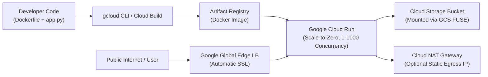
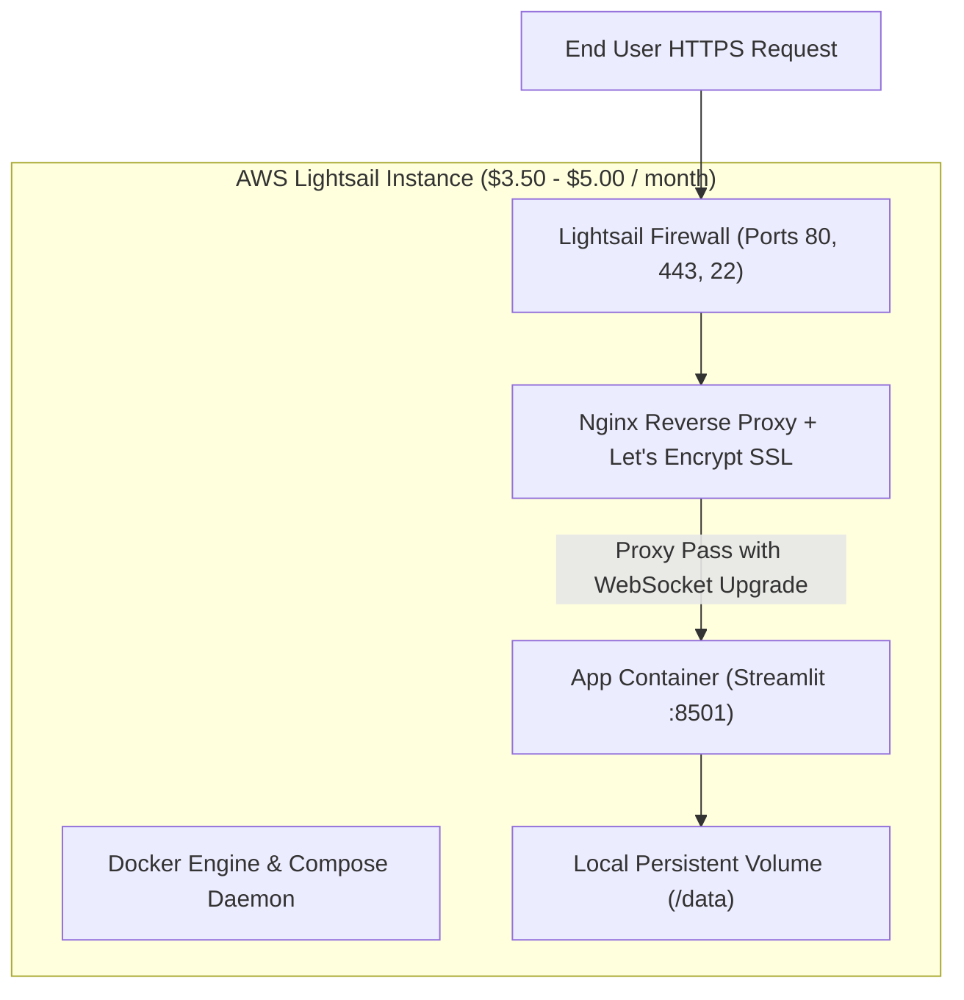
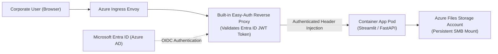
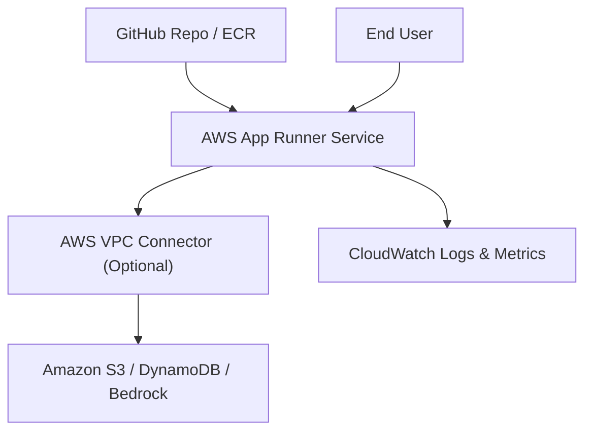
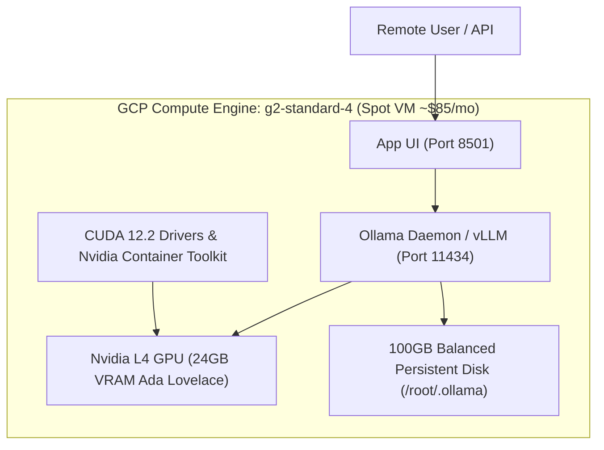
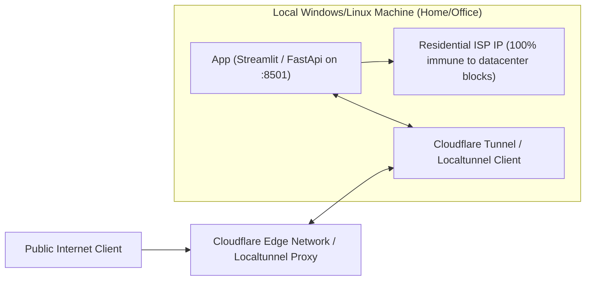
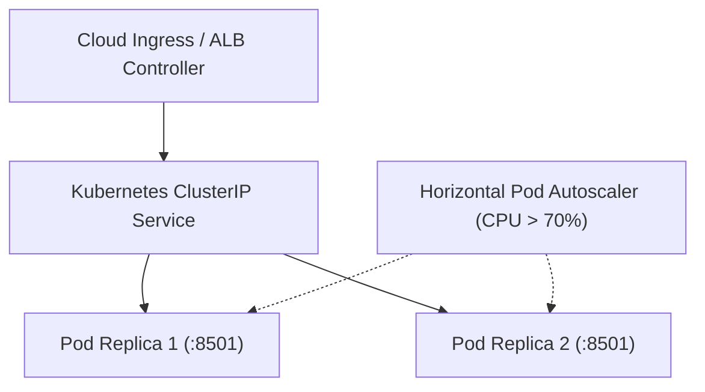

# 🛠️ Step-by-Step Production Deployment Playbooks

This guide provides concrete, copy-paste deployment playbooks for **every major strategy** evaluated by the Decision Engine. Each section contains an end-to-end architecture flowchart, prerequisites, build commands, production configurations, and health-check verification steps.

---

## 📑 Table of Contents
1. [Strategy 1: Google Cloud Run (Serverless Web App / Streamlit / API)](#strategy-1-google-cloud-run)
2. [Strategy 2: AWS Lightsail (Predictable Flat-Fee VPS with Docker & SSL)](#strategy-2-aws-lightsail)
3. [Strategy 3: Azure Container Apps (ACA) with Entra ID SSO](#strategy-3-azure-container-apps)
4. [Strategy 4: AWS App Runner & ECS Fargate](#strategy-4-aws-app-runner--ecs-fargate)
5. [Strategy 5: GCP Compute Engine G2 Dedicated GPU Host (Nvidia L4 24GB)](#strategy-5-gcp-compute-engine-g2-gpu-host)
6. [Strategy 6: AWS EC2 G4dn Dedicated GPU Host (Nvidia T4 16GB)](#strategy-6-aws-ec2-g4dn-gpu-host)
7. [Strategy 7: Local Edge Production & Residential Scraper (Zero-Cost)](#strategy-7-local-edge-production)
8. [Strategy 8: Kubernetes on GCP GKE Autopilot & AWS EKS](#strategy-8-kubernetes-deployment)

---

## Strategy 1: Google Cloud Run

**Best for**: Free-tier MVPs, high-concurrency Streamlit apps, FastAPI, and scale-to-zero workloads.

### 1.1 Architecture Flowchart



### 1.2 Step-by-Step Execution

#### Step 1: Prepare the Dockerfile
Ensure your Dockerfile binds to the `$PORT` environment variable provided by Cloud Run:
```dockerfile
FROM python:3.11-slim
WORKDIR /app
COPY requirements.txt .
RUN pip install --no-cache-dir -r requirements.txt
COPY . .
ENV PORT=8501
EXPOSE 8501
CMD exec streamlit run app.py --server.port=${PORT} --server.address=0.0.0.0 --server.headless=true
```

#### Step 2: Authenticate and Enable APIs
```bash
# 1. Login to Google Cloud
gcloud auth login
gcloud config set project YOUR_PROJECT_ID

# 2. Enable necessary GCP APIs
gcloud services enable run.googleapis.com artifactregistry.googleapis.com
```

#### Step 3: Deploy Directly from Source
Cloud Run builds and packages the container automatically:
```bash
gcloud run deploy youtranscribe \
  --source . \
  --region us-central1 \
  --platform managed \
  --allow-unauthenticated \
  --port 8501 \
  --memory 1Gi \
  --cpu 1 \
  --concurrency 80 \
  --timeout 3600 \
  --min-instances 0 \
  --max-instances 5
```
> [!TIP]
> The `--timeout 3600` flag is critical for Streamlit and real-time streaming, allowing WebSocket connections to remain open for up to 1 hour without dropping.

#### Step 4: Map Custom Domain (Optional)
```bash
gcloud beta run domain-mappings create \
  --service youtranscribe \
  --domain app.yourdomain.com \
  --region us-central1
```

---

## Strategy 2: AWS Lightsail

**Best for**: Predictable $3.50–$5.00/mo budget, continuous background workers, and static IPv4 egress.

### 2.1 Architecture Flowchart



### 2.2 Step-by-Step Execution

#### Step 1: Provision the Lightsail Instance
```bash
aws lightsail create-instances \
  --instance-names app-vps \
  --availability-zone us-east-1a \
  --blueprint-id ubuntu_22_04 \
  --bundle-id nano_2_0
```

#### Step 2: Attach a Static Public IPv4 Address
```bash
# Allocate static IP
aws lightsail allocate-static-ip --static-ip-name app-static-ip

# Attach to instance
aws lightsail attach-static-ip --static-ip-name app-static-ip --instance-name app-vps

# Open Ports 80 and 443 in Firewall
aws lightsail open-instance-ports --instance-name app-vps --port-info fromPort=80,toPort=80,protocol=TCP
aws lightsail open-instance-ports --instance-name app-vps --port-info fromPort=443,toPort=443,protocol=TCP
```

#### Step 3: Setup Docker & Docker Compose on Instance
SSH into the instance and configure Docker:
```bash
ssh ubuntu@YOUR_STATIC_IP

# Install Docker & Compose
sudo apt-get update && sudo apt-get install -y docker.io docker-compose-v2
sudo usermod -aG docker ubuntu
```

#### Step 4: Deploy `docker-compose.yml` with Nginx SSL
Create `docker-compose.yml`:
```yaml
version: '3.8'
services:
  app:
    image: python:3.11-slim
    restart: always
    working_dir: /app
    volumes:
      - .:/app
    command: python -m streamlit run app.py --server.port 8501 --server.address 127.0.0.1
    network_mode: "host"

  nginx:
    image: nginx:alpine
    restart: always
    network_mode: "host"
    volumes:
      - ./nginx.conf:/etc/nginx/nginx.conf:ro
      - /etc/letsencrypt:/etc/letsencrypt:ro
```

Configure `nginx.conf` for WebSocket streaming:
```nginx
server {
    listen 80;
    server_name app.yourdomain.com;
    return 301 https://$host$request_uri;
}

server {
    listen 443 ssl;
    server_name app.yourdomain.com;
    ssl_certificate /etc/letsencrypt/live/app.yourdomain.com/fullchain.pem;
    ssl_certificate_key /etc/letsencrypt/live/app.yourdomain.com/privkey.pem;

    location / {
        proxy_pass http://127.0.0.1:8501;
        proxy_http_version 1.1;
        proxy_set_header Upgrade $http_upgrade;
        proxy_set_header Connection "upgrade";
        proxy_set_header Host $host;
        proxy_read_timeout 86400;
    }
}
```

---

## Strategy 3: Azure Container Apps

**Best for**: Enterprise corporate SaaS, Microsoft 365 integration, and native Entra ID (Azure AD) SSO.

### 3.1 Architecture Flowchart



### 3.2 Step-by-Step Execution

#### Step 1: Create Resource Group and Container Registry
```bash
# 1. Login
az login
az account set --subscription "YOUR_SUBSCRIPTION_ID"

# 2. Create Resource Group & ACR
az group create --name my-enterprise-rg --location eastus
az acr create --resource-group my-enterprise-rg --name myacrregistry --sku Basic --admin-enabled true
```

#### Step 2: Build Image directly in ACR
```bash
az acr build --registry myacrregistry --image enterprise-app:v1 .
```

#### Step 3: Create Container Apps Environment & App
```bash
# 1. Create ACA Environment
az containerapp env create \
  --name my-aca-env \
  --resource-group my-enterprise-rg \
  --location eastus

# 2. Deploy Container App
az containerapp create \
  --name enterprise-app \
  --resource-group my-enterprise-rg \
  --environment my-aca-env \
  --image myacrregistry.azurecr.io/enterprise-app:v1 \
  --target-port 8501 \
  --ingress external \
  --min-replicas 0 \
  --max-replicas 5 \
  --cpu 0.5 \
  --memory 1.0Gi
```

#### Step 4: Enable Entra ID (Azure AD) Easy-Auth
Enable zero-code authentication proxy without editing your source code:
```bash
az containerapp auth microsoft update \
  --name enterprise-app \
  --resource-group my-enterprise-rg \
  --client-id "YOUR_AZURE_AD_APP_CLIENT_ID" \
  --client-secret "YOUR_CLIENT_SECRET" \
  --tenant-id "YOUR_TENANT_ID" \
  --action RedirectToLoginPage
```

---

## Strategy 4: AWS App Runner & ECS Fargate

**Best for**: Fully-managed AWS native container hosting with IAM role bindings.

### 4.1 Architecture Flowchart



### 4.2 Step-by-Step Execution

#### Step 1: Authenticate and Push Image to AWS ECR
```bash
# 1. Create ECR repository
aws ecr create-repository --repository-name my-aws-app --region us-east-1

# 2. Login Docker to ECR
aws ecr get-login-password --region us-east-1 | docker login --username AWS --password-stdin YOUR_ACCOUNT_ID.dkr.ecr.us-east-1.amazonaws.com

# 3. Tag and push
docker tag my-app:latest YOUR_ACCOUNT_ID.dkr.ecr.us-east-1.amazonaws.com/my-aws-app:latest
docker push YOUR_ACCOUNT_ID.dkr.ecr.us-east-1.amazonaws.com/my-aws-app:latest
```

#### Step 2: Deploy App Runner Service via CLI
```bash
aws apprunner create-service \
  --service-name my-aws-app \
  --source-configuration '{
    "ImageRepository": {
      "ImageIdentifier": "YOUR_ACCOUNT_ID.dkr.ecr.us-east-1.amazonaws.com/my-aws-app:latest",
      "ImageConfiguration": {
        "Port": "8501",
        "RuntimeEnvironmentVariables": [
          {"Name": "STREAMLIT_SERVER_PORT", "Value": "8501"}
        ]
      },
      "ImageRepositoryType": "ECR"
    },
    "AutoDeploymentsEnabled": true
  }' \
  --instance-configuration '{"Cpu": "1 vCPU", "Memory": "2 GB"}'
```

---

## Strategy 5: GCP Compute Engine G2 GPU Host

**Best for**: On-premise style dedicated LLMs (Ollama, Whisper Large, vLLM, PyTorch) with 24GB VRAM.

### 5.1 Architecture Flowchart



### 5.2 Step-by-Step Execution

#### Step 1: Provision Spot VM with Nvidia L4 GPU
```bash
gcloud compute instances create ai-gpu-host \
  --zone us-central1-a \
  --machine-type g2-standard-4 \
  --accelerator type=nvidia-l4,count=1 \
  --image-family common-cu121-debian-11-py310 \
  --image-project deeplearning-platform-release \
  --boot-disk-size 100GB \
  --boot-disk-type pd-balanced \
  --maintenance-policy TERMINATE \
  --provisioning-model SPOT
```

#### Step 2: SSH and Verify Nvidia Hardware
```bash
gcloud compute ssh ai-gpu-host --zone us-central1-a

# Verify GPU is active
nvidia-smi
```
*(You will see `NVIDIA L4` with 23034MiB VRAM).*

#### Step 3: Install and Service-Wrap Ollama
```bash
# Install Ollama
curl -fsSL https://ollama.com/install.sh | sh

# Pre-download required AI models
ollama run llama3.1:8b-instruct-q4_K_M ""
ollama pull whisper:large-v3
```

#### Step 4: Configure Systemd Auto-Start
Ensure the app restarts automatically if the Spot VM is preempted and restarted:
```bash
sudo tee /etc/systemd/system/ai-app.service > /dev/null <<EOF
[Unit]
Description=AI Application Service
After=network.target ollama.service

[Service]
Type=simple
User=ubuntu
WorkingDirectory=/home/ubuntu/app
ExecStart=/usr/bin/python3 -m streamlit run app.py --server.port 8501 --server.address 0.0.0.0
Restart=always
RestartSec=5

[Install]
WantedBy=multi-user.target
EOF

sudo systemctl daemon-reload
sudo systemctl enable --now ai-app.service
```

---

## Strategy 6: AWS EC2 G4dn GPU Host

**Best for**: CUDA workloads, Whisper, and moderate deep learning models requiring Nvidia T4 (16GB VRAM).

### 6.1 Step-by-Step Execution

#### Step 1: Launch EC2 Spot Instance with Deep Learning AMI
```bash
aws ec2 run-instances \
  --image-id ami-07b9a52762a4208a0 \
  --instance-type g4dn.xlarge \
  --instance-market-options '{"MarketType":"spot","SpotOptions":{"SpotInstanceType":"persistent"}}' \
  --key-name my-key \
  --security-group-ids sg-xxxxxx \
  --block-device-mappings '[{"DeviceName":"/dev/sda1","Ebs":{"VolumeSize":100,"VolumeType":"gp3"}}]'
```

#### Step 2: Run GPU Containers with Nvidia Toolkit
```bash
docker run --gpus all -d \
  -p 8501:8501 \
  -v $(pwd):/app \
  --restart always \
  pytorch/pytorch:2.2.0-cuda12.1-cudnn8-runtime \
  python /app/app.py
```

---

## Strategy 7: Local Edge Production

**Best for**: $0.00 cost, scraping protected targets (YouTube, Cloudflare-guarded APIs), and utilizing local RTX GPUs.

### 7.1 Architecture Flowchart



### 7.2 Step-by-Step Execution

#### Step 1: Run Locally with Secure Tunneling
Use the unified local script:
```cmd
run.bat
```
Select **Option 2** (*Run App + Start HTTPS Public Tunnel*).

#### Step 2: Production Setup with Cloudflare Named Tunnel (Zero Trust)
For enterprise-grade edge stability with your own domain name:
```bash
# 1. Install cloudflared
winget install --id Cloudflare.cloudflared

# 2. Authenticate
cloudflared tunnel login

# 3. Create persistent tunnel
cloudflared tunnel create my-app-tunnel

# 4. Route traffic to local port 8501
cloudflared tunnel route dns my-app-tunnel transcribe.yourdomain.com
cloudflared tunnel run --url http://localhost:8501 my-app-tunnel
```

---

## Strategy 8: Kubernetes Deployment

**Best for**: Multi-microservice architectures, automated blue/green deployments, and Kubernetes-standard organizations.

### 8.1 Architecture Flowchart



### 8.2 Kubernetes Manifest (`deployment.yaml`)
```yaml
apiVersion: apps/v1
kind: Deployment
metadata:
  name: cloud-app
  labels:
    app: cloud-app
spec:
  replicas: 2
  selector:
    matchLabels:
      app: cloud-app
  template:
    metadata:
      labels:
        app: cloud-app
    spec:
      containers:
      - name: web
        image: gcr.io/YOUR_PROJECT/cloud-app:latest
        ports:
        - containerPort: 8501
        resources:
          requests:
            cpu: "250m"
            memory: "512Mi"
          limits:
            cpu: "1000m"
            memory: "1024Mi"
        readinessProbe:
          httpGet:
            path: /_stcore/health
            port: 8501
          initialDelaySeconds: 5
          periodSeconds: 10
---
apiVersion: v1
kind: Service
metadata:
  name: cloud-app-service
spec:
  type: ClusterIP
  selector:
    app: cloud-app
  ports:
  - port: 80
    targetPort: 8501
```

Apply to cluster:
```bash
kubectl apply -f deployment.yaml
```
