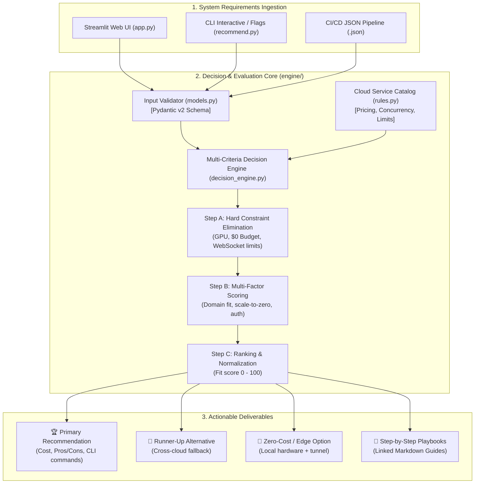
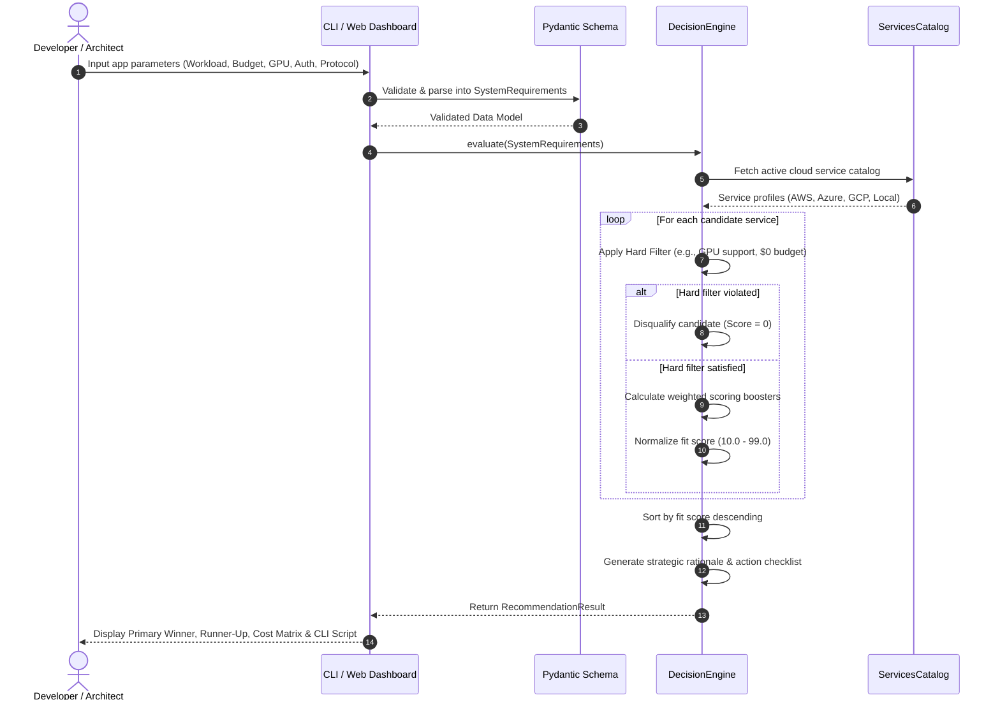

# ⚙️ System Architecture & Specification: Cloud Deployment Decision Engine

## 1. 📌 Executive Overview

The **Cloud Deployment Strategy Decision Engine** is an automated recommendation and architecture sizing system designed to eliminate cloud decision paralysis. It ingests formal application requirements across technical, financial, and operational dimensions and matches them against catalogued cloud architectures in **Amazon Web Services (AWS)**, **Microsoft Azure**, **Google Cloud Platform (GCP)**, and **Local Edge environments**.

The system is delivered as:
1. **Python Core Engine (`engine/`)**: A modular, type-safe decision pipeline built with Pydantic.
2. **CLI Executable (`recommend.py`)**: An interactive wizard and scriptable CLI for automated pipelines.
3. **Interactive Web Dashboard (`app.py`)**: A visual Streamlit dashboard with real-time score updates and command generators.

---

## 2. 🏛️ System Architecture

### 2.1 Component Flowchart



### 2.2 Sequence Diagram: Requirement Evaluation Lifecycle



---

## 3. 📐 Input Schema & Requirement Ontology

The engine enforces a strict typed schema via Pydantic in [engine/models.py](file:///d:/AI/deployment-strategies/engine/models.py):

| Parameter | Type | Permitted Values | Architectural Impact |
|---|---|---|---|
| `workload_type` | `WorkloadType` | `web_app`, `rest_api`, `ai_inference_gpu`, `ai_inference_cpu`, `scraper_worker`, `event_worker`, `microservices` | Determines container runtime, concurrency settings, and hardware limits. |
| `budget_tier` | `BudgetTier` | `free_tier`, `ultra_low`, `flat_budget`, `standard`, `enterprise` | Controls scale-to-zero eligibility, VPS selection, or enterprise SLA clusters. |
| `traffic_pattern` | `TrafficPattern` | `sporadic`, `predictable`, `high_sustained` | Triggers scale-to-zero algorithms vs. reserved instance pricing. |
| `gpu_requirement` | `GPURequirement` | `none`, `light_gpu` (8-16GB), `heavy_gpu` (24GB+) | Filters out serverless platforms; routes to Nvidia L4 / T4 GPU hosts. |
| `auth_requirement` | `AuthRequirement` | `public_none`, `microsoft_entra`, `aws_iam`, `gcp_iam` | Boosts clouds with native reverse-proxy SSO (e.g., Azure Container Apps). |
| `protocol` | `ProtocolRequirement` | `standard_http`, `websocket`, `background_task` | Validates persistent connection timeouts (e.g. 3600s WebSockets). |
| `storage` | `StorageRequirement` | `stateless`, `persistent_volume`, `managed_db` | Enforces SMB (Azure Files), FUSE (GCS), or EFS volume mount support. |
| `team_cloud_familiarity` | `str` | `any`, `aws`, `azure`, `gcp` | Incorporates human capital and institutional preference biases. |

---

## 4. 🧮 Multi-Criteria Decision Algorithm (MCDA)

The engine evaluates candidates through a two-phase pipeline:

### 4.1 Phase 1: Hard Constraint Elimination (Zero-Tolerance Filters)
A service is instantly assigned a fit score of `0.0` if:
1. **GPU Mismatch**: The application requires `light_gpu` or `heavy_gpu`, but the service is a serverless container without dedicated GPU support (e.g., standard Cloud Run, standard App Runner).
2. **Budget Breach**: The user requires `free_tier` ($0/mo), but the service enforces a mandatory baseline idle cost (e.g., AWS Lightsail at $3.50/mo or ECS Fargate at $15/mo).
3. **Protocol Incompatibility**: The user requires streaming `websocket`, but the service lacks persistent TCP connection support or enforces timeouts $<60$ seconds.

### 4.2 Phase 2: Soft Scoring Matrix & Boosters
For surviving candidates, the base score starts at `50.0` and accumulates weighted modifiers:

$$\text{FitScore} = \text{Clamp}_{10}^{99}\left(50 + \Delta_{\text{Workload}} + \Delta_{\text{Traffic}} + \Delta_{\text{Budget}} + \Delta_{\text{Auth}} + \Delta_{\text{Hardware}} + \Delta_{\text{Team}}\right)$$

* **Workload Domain Match**: $+20$ points when service is purpose-built for that specific workload.
* **Scale-to-Zero Match**: $+25$ points for sporadic traffic on scale-to-zero infrastructure; $-15$ points for always-on VMs.
* **Free-Tier Eligibility**: $+25$ points when service offers permanent monthly free allowances (e.g., GCP Cloud Run 2M requests).
* **Flat-Budget Match**: $+35$ points for managed VPS with bundled bandwidth (e.g., AWS Lightsail).
* **Microsoft Entra ID Synergy**: $+40$ points for Azure services providing zero-code Easy-Auth; $-20$ points for other clouds requiring custom OIDC proxy code.
* **GPU Capacity Optimization**: $+35$ points for GCP L4 (24GB Ada Lovelace) on heavy LLMs; $-20$ points for older T4 (16GB Turing) on 24GB workloads.
* **Team Skill Alignment**: $+15$ points matching existing team cloud competence.

---

## 5. 💻 Interfaces & Usage Modes

### 5.1 Interactive CLI Wizard
Run the interactive wizard directly in your terminal:
```bash
python recommend.py -i
```
Prompts the user step-by-step through application attributes and outputs a formatted terminal report with fit scores and copy-paste CLI commands.

### 5.2 Command-Line Flag Execution
Pass explicit parameters for automated scripts or rapid queries:
```bash
python recommend.py \
  --app-name "YouTranscribe" \
  --workload web_app \
  --budget free_tier \
  --traffic sporadic \
  --protocol websocket
```

### 5.3 Automated JSON Pipeline Mode
Integrate into CI/CD pipelines or infrastructure-as-code generators:
```bash
# Output recommendation as structured JSON
python recommend.py --workload ai_inference_gpu --gpu heavy_gpu --json-output > decision.json
```

### 5.4 Interactive Web Dashboard
Launch the graphical browser interface:
```bash
streamlit run app.py
```
Provides visual dropdowns, live cost recalculation, and one-click copyable deployment commands.

---

## 6. 🧪 Validation & Reference Benchmark Profiles

| Profile Name | Input Parameters | System Output Winner | Fit Score | Key Reason |
|---|---|---|---|---|
| **YouTranscribe MVP** | `web_app`, `free_tier`, `sporadic`, `websocket` | **GCP Cloud Run** | **99.0** | 2M free requests/mo, true scale-to-zero, native WebSockets |
| **Corporate Intranet** | `web_app`, `enterprise`, `microsoft_entra` | **Azure Container Apps** | **99.0** | Built-in Entra ID SSO proxy without modifying app code |
| **Local LLM Host** | `ai_inference_gpu`, `heavy_gpu`, `standard` | **GCP Compute Engine G2** | **99.0** | Nvidia L4 24GB VRAM Ada Lovelace GPU at ~$85/mo Spot |
| **Fixed Budget VPS** | `web_app`, `flat_budget`, `predictable` | **AWS Lightsail** | **95.0** | Fixed $3.50–$5.00/mo flat fee with 1TB–2TB bandwidth |
| **YouTube Scraper** | `scraper_worker`, `ultra_low`, `stateless` | **Local Production Tunnel** | **99.0** | Residential IP prevents YouTube bot detection and 429 blocks |
| **Microservices Mesh** | `microservices`, `standard`, `managed_db` | **GCP GKE Autopilot** | **90.0** | Hands-off Kubernetes node management and auto-repair |
