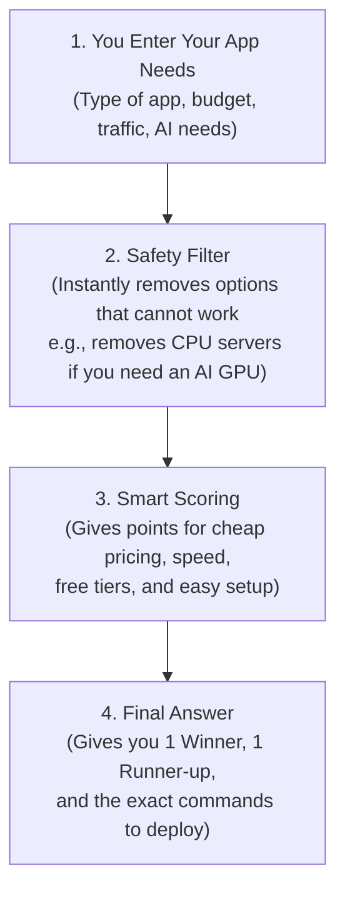

# ⚙️ How the Cloud Decision Assistant Works (Behind the Scenes)

> **In Plain English:**  
> Picking a cloud provider can feel like ordering food from a 100-page menu in a foreign language.  
> We built the **Cloud Decision Assistant** to act like a knowledgeable friend: you tell it what your app does and what your budget is, and it instantly recommends the best cloud service, estimates your bill, and gives you the exact commands to launch it.

---

## 1. 🌟 The 3 Ways You Can Use This Tool

1. **In Your Web Browser (Easiest)**:  
   Open the Streamlit app ([`app.py`](./app.py)) to click buttons, select options, and see results instantly.
2. **In Your Terminal (Interactive Wizard)**:  
   Type `python recommend.py -i` and answer a few simple questions.
3. **In Scripts & Automation**:  
   Run `python recommend.py --workload web_app --budget free_tier` for quick automated answers.

---

## 2. 🏛️ How the Decision Engine Thinks

Here is what happens under the hood when you enter your requirements:

---

## 3. 📋 The Questions the Assistant Asks You (Explained Simply)

| Setting Name | What it Means in Plain English | Options You Can Pick | Why it Matters |
|---|---|---|---|
| **Workload Type** | What kind of program did you build? | Web App (Streamlit), REST API, AI Model (Ollama), Web Scraper | Different apps need different types of cloud computers. |
| **Budget Tier** | How much money do you want to spend? | $0 (Free Tier), Ultra-low (<$5/mo), Fixed ($3.50-$5/mo), Enterprise | Prevents you from choosing expensive services when you have zero budget. |
| **Traffic Pattern** | How often do people visit your site? | Sporadic (Few visits per day), Steady (Constantly busy) | If visits are sporadic, "Scale-to-Zero" saves you 100% of idle costs. |
| **GPU Acceleration**| Does your app need a graphics card for AI? | None (Regular CPU), Light GPU (T4), Heavy GPU (L4 24GB) | Running local LLMs (like Ollama or Whisper) requires a dedicated GPU. |
| **Authentication** | How do users log into your site? | None / Public, Microsoft 365 (Azure AD), AWS IAM | If you need Microsoft company login, Azure does it in one click! |
| **Connection (Protocol)** | Does your app stream live text or chat? | Standard HTTP, Live Streaming (WebSockets) | Streamlit needs long-lived WebSockets so live updates don't disconnect. |
| **Team Cloud Experience**| Do you or your team already know one cloud? | Any, Google Cloud, AWS, Microsoft Azure | It's usually easiest to stick with what you already know. |

---

## 4. 🧮 How It Scores and Picks the Winner

The engine uses two simple steps:

### Step 1: The Elimination Round (Hard Rules)
The system immediately throws out any cloud service that physically cannot run your app:
* *Example 1*: If you need a heavy AI GPU, serverless containers (like standard Cloud Run) are eliminated because they don't have dedicated graphics cards.
* *Example 2*: If your budget is strictly $0, paid VPS servers (like AWS Lightsail at $3.50/mo) are eliminated.

### Step 2: The Points Round (Scoring the Survivors)
The remaining options receive points based on how well they fit:
* **+$25 points**: If the service has a permanent free tier (like Google Cloud Run's 2 million free monthly requests).
* **+$25 points**: If the service turns off when nobody is using it (saving you money while you sleep).
* **+$40 points**: If you need Microsoft company login and pick Microsoft Azure (because Azure does this with zero code).
* **+$35 points**: If you want a fixed, predictable budget and pick AWS Lightsail ($3.50/month flat).

The service with the highest score wins the **Gold Medal (Primary Recommendation)**, and the second-highest wins the **Silver Medal (Runner-Up)**!

---

## 5. 🧪 5 Real Examples and What the Engine Recommends

| If you ask for... | The Assistant Recommends | Why This Won |
|---|---|---|
| **A personal Streamlit website with $0 budget** | **Google Cloud Run (GCP)** | 2 million free visits every month and $0 idle cost. |
| **An app for your company where staff log in with Microsoft 365** | **Azure Container Apps** | Turnkey Microsoft login without writing any login code. |
| **Running your own local AI brain (Ollama / Whisper)** | **Google Compute Engine (Nvidia L4 GPU)** | Modern 24GB graphics card at an 80% Spot discount (~$85/mo). |
| **A simple website with a guaranteed fixed $5/mo bill** | **AWS Lightsail** | Flat $3.50 or $5.00 a month with 1,000 GB of free bandwidth. |
| **A YouTube transcriber or web scraper** | **Your Own PC (`run.bat`)** | Free forever, and YouTube won't block your home Wi-Fi IP address. |
